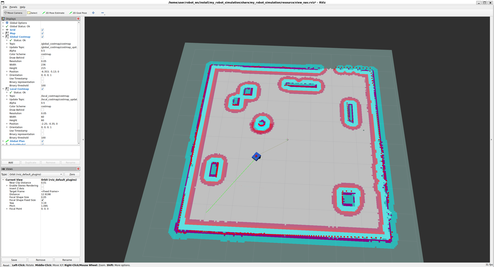
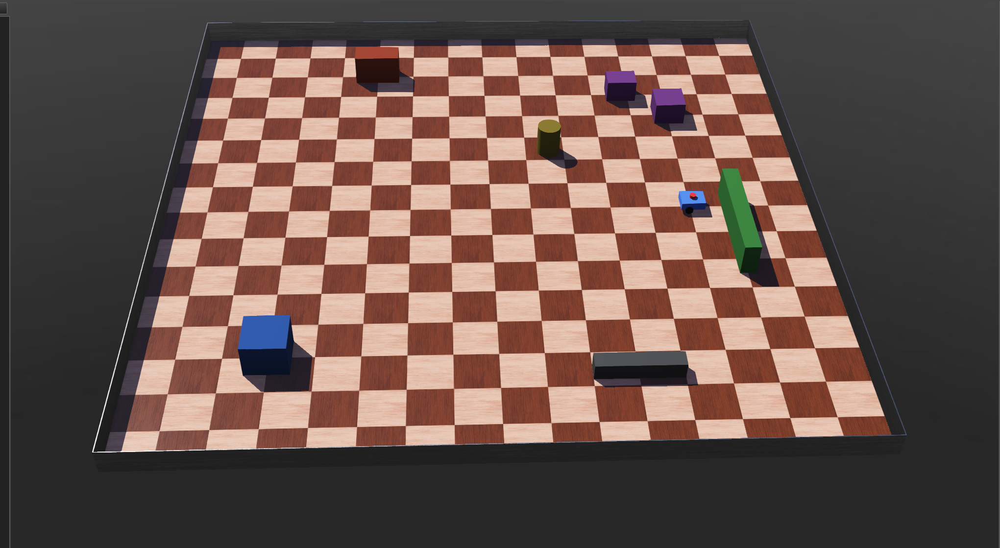
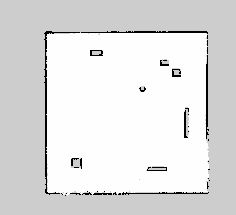
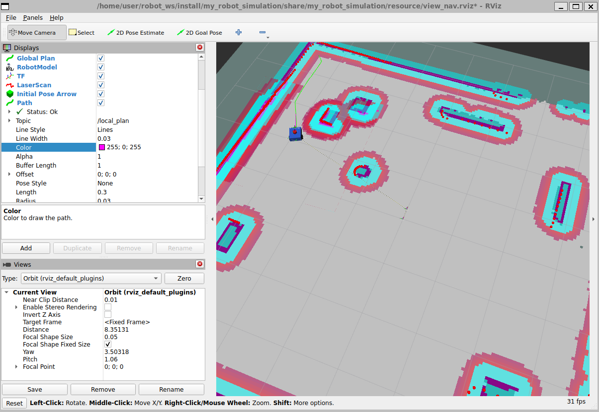

# ROS 2 로봇 프로그래밍 실습

숭실대학교 「로봇프로그래밍」(2026년 1학기) 수업에서 직접 구현한 ROS 2 패키지 모음입니다.
Topic 통신부터 Service 통신(Parameter·Launch 포함), 차동구동 이동로봇의 피드백 제어와 SLAM·Nav2 자율주행까지 단계별로 정리했습니다.

- 환경: Ubuntu 24.04 (WSL2), ROS 2 Jazzy, Python (rclpy), Webots R2025a
- 언어: Python

<p align="center">
  
</p>

## 구성

| 단계 | 패키지 | 내용 |
|---|---|---|
| 1. Topic | [`counter_pub_sub`](01_topic/counter_pub_sub) | 정수 카운터 발행·구독, 10의 배수에서 경고 로그 |
| | [`temp_monitor`](01_topic/temp_monitor) | 온도 센서 시뮬레이터(기준값 + 정현파 + 노이즈)와 임계값 감시 구독자 |
| | [`multi_topic_monitor`](01_topic/multi_topic_monitor) | 온도·습도 두 토픽을 동시에 구독해 최솟값·최댓값·누적 평균 집계, 고온·고습 경고 |
| 2. Service·Parameter·Launch | [`temp_converter_interfaces`](02_service/temp_converter_interfaces) | 직접 정의한 서비스 타입 `TempConvert.srv` |
| | [`temp_converter`](02_service/temp_converter) | 섭씨↔화씨 변환 서비스 서버·클라이언트, YAML 파라미터와 launch 인자, 소수점 자리수 실행 중 변경 |
| 3. 이동로봇 제어 | [`mobile_robot_nodes`](03_mobile_robot/mobile_robot_nodes) | odom 피드백 360° 회전, 토픽 실시간 검증, LiDAR 장애물 감지 후 후진 |
| 4. SLAM·Nav2 | [`maps`](03_mobile_robot/maps) | Cartographer로 직접 작성한 지도, 이 지도로 Nav2 자율주행 |

## 1. Topic 통신

```bash
ros2 run counter_pub_sub counter_pub        # /counter 발행
ros2 run counter_pub_sub counter_sub

ros2 run temp_monitor temp_sensor_pub       # /temperature 발행
ros2 run temp_monitor temp_monitor_sub

ros2 run multi_topic_monitor sensor_pub     # /sensor/temperature, /sensor/humidity
ros2 run multi_topic_monitor data_agg       # 두 토픽 집계 + 경고
```

## 2. Service 통신 (Parameter·Launch 포함)

서버·클라이언트 설정은 YAML 파라미터 파일(`config/`)로 분리하고, launch 파일 하나로 두 노드를 함께 실행합니다.
클라이언트 요청 주기는 launch 인자로, 결과 소수점 자리수는 실행 중 `ros2 param set`으로 바꿀 수 있습니다.

```text
# TempConvert.srv
float64 temperature   # 입력 온도
string unit           # "C" 또는 "F"
---
float64 converted
string result_unit
bool success
string message        # 오류 시 원인
```

```bash
ros2 launch temp_converter temp_converter_launch.py request_period:=0.5
ros2 service call /convert_temperature temp_converter_interfaces/srv/TempConvert "{temperature: 100.0, unit: 'C'}"
ros2 param set /temp_converter_server decimal_places 4   # 실행 중 결과 자리수 변경
```

## 3. 차동구동 이동로봇 제어

수업에서 제공된 Webots 시뮬레이션 패키지(2륜 차동구동 로봇, `diff_drive_controller`) 위에서 동작하는 노드를 직접 작성했습니다.
세 노드 모두 표준 토픽만 사용하므로(`/cmd_vel` TwistStamped, `/odom`, `/scan`, `/tf`) 같은 인터페이스를 가진 다른 차동구동 로봇에서도 실행할 수 있습니다.

| 노드 | 동작 | 구현 포인트 |
|---|---|---|
| `spin_360` | odom 피드백으로 정확히 360° 회전 후 정지 | yaw 변화량을 [-π, π]로 정규화해 누적, 남은 각도가 작아지면 감속, 오차 허용 0.01 rad |
| `topic_verifier` | `/cmd_vel`, `/odom`, `/scan`, `/tf`를 1초마다 표로 출력 | odom 발행 주파수 측정(1초 이동 창), `odom → base_link` TF 조회 |
| `obstacle_avoid` | 전방 ±15°, 0.5 m 안에 장애물이 있으면 2초 후진 후 정지 | LiDAR 각도 증분 부호와 무관하게 전방 구간 계산, 센서 QoS(BEST_EFFORT), 타이머 기반 후진 |

```bash
ros2 run mobile_robot_nodes topic_verifier   # teleop과 함께 실행해 토픽 관찰
ros2 run mobile_robot_nodes spin_360
ros2 run mobile_robot_nodes obstacle_avoid
```

수업 제공 패키지에서 함께 수정한 내용 (원본 파일은 이 저장소에 포함하지 않음):
- LiDAR 각도 증분이 음수인 경우에도 전방 구간을 올바르게 잡도록 장애물 정지 노드의 인덱스 계산 수정
- 로봇 URDF(xacro)에 휠 축 전후 오프셋 파라미터를 추가해, 휠 위치 오차가 odom 누적 오차에 주는 영향 실험

<p align="center">
  
</p>

## 4. SLAM과 Nav2 자율주행

Cartographer로 시뮬레이션 환경(8 m × 8 m, 장애물 7개)을 주행하며 지도를 작성하고, 저장한 지도로 Nav2 자율주행을 수행했습니다.

| 작성한 지도 (`maps/my_map.pgm`, 0.05 m/px) | Nav2 지역 경로 추종 |
|---|---|
|  |  |

```bash
# 지도 저장 (Cartographer /map은 transient_local QoS)
ros2 run nav2_map_server map_saver_cli -f maps/my_map \
  --ros-args -p map_subscribe_transient_local:=true -p save_map_timeout:=10.0
```

## 빌드

```bash
mkdir -p ~/ros2_ws/src && cd ~/ros2_ws/src
git clone https://github.com/sean237333/ros2-robot-programming.git
cd ~/ros2_ws
source /opt/ros/jazzy/setup.bash
colcon build
source install/setup.bash
```

## 참고

- 3·4단계의 Webots 월드, 로봇 모델, launch, Cartographer·Nav2 설정은 수업에서 제공된 `my_robot_simulation` 패키지(로봇프로그래밍 강의, 한영준 교수님)를 사용했으며 이 저장소에는 포함하지 않았습니다.
- 강의자료, 과제 안내문, 제출 보고서는 포함하지 않았습니다.
